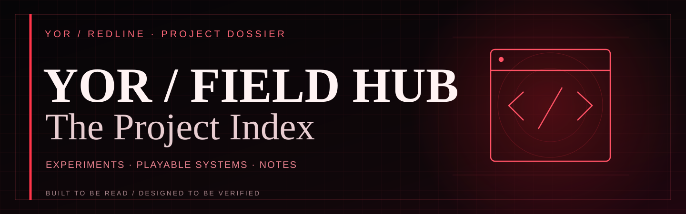

<!-- YOR REDLINE / README COVER V1 -->
<div align="center">

<picture><source media="(max-width: 600px)" srcset="docs/yor-redline-cover-mobile.svg"/></picture>

<sub><strong>YOR / PROJECT DOSSIER</strong> · <a href="https://github.com/yorayriniwnl">GitHub</a> · <a href="https://yorayriniwnl.in">Portfolio</a></sub>

</div>
<!-- END YOR REDLINE -->

# YOR // War Room

> A real-time three.js portfolio set inside the crimson war room from the
> "Neon Warroom with Husky and Arsenal" painting: the masked operator, the
> husky in a gas mask and helmet, the engraved rifle, the eclipse poster and a
> rain-streaked skyline. Every 3D model is generated from code in `art/`.

| Surface / claim | State | Boundary |
|---|---|---|
| War room scene, scroll camera, project cards, arcade | VERIFIED | Builds, type-checks and renders in headless Chromium on desktop and phone sizes. |
| Arcade rooms | DEMO | Games run in the local client; each game's depth is separate from the scene. |
| Project metrics and links | REPORTED | Authored metadata with a dated scope next to each number; recheck before relying on them. |
| Procedural models (`art/`) | EXPERIMENTAL | Stylised, generated with Blender's Python API; not hand-sculpted or scanned. |
| Public deployment | UNVERIFIED | Hosting and external-link health need a live check. |
| Additional integrations | PLANNED | Broader accounts and data sources stay outside this repository's verified runtime. |

The shell follows the YOR visual contract: `#000000` void, `#050505` graphite,
`#e84b4b` crimson, `#671515` deep crimson, `#ff8a7f` signal, `#f5eaea` warm white,
`#c4c4c4` muted text, and the `#671515 → #8c1616 → #2a0505` field gradient.
Run `npm run design:check` to guard the contract.

The canonical recruiter-facing portfolio is maintained in [Portfolio-Ayush-Roy](https://github.com/yorayriniwnl/Portfolio-Ayush-Roy) and deployed at [yorayriniwnl.in](https://yorayriniwnl.in).

## Run locally

```bash
npm install
npm run dev
```

Useful query flags: `?q=low` or `?q=high` forces a quality tier, `?dpr=0.75`
caps the pixel ratio, `?rm` forces reduced motion. Without WebGL the page
falls back to the reference painting and keeps every section readable.

## Build

```bash
npm run build
npm run preview
```

## How the room works

- **Scroll drives the camera.** Each page section owns a camera shot in
  `src/scene/shots.ts` (with a portrait variant for phones). Scrolling
  interpolates between shots; the pointer adds parallax and the operator and
  husky heads follow it.
- **Project cards drive the laptop.** As an operation card enters the
  viewport, the laptop screen on the table redraws with its name and ping.
- **Scene code** lives in `src/scene/`: `WarRoom.ts` (renderer, lights, post
  chain with bloom, chromatic fringe, vignette and grain), `room.ts` (walls,
  window, neon sign, painting, poster, bookshelf), `outside.ts` (sky, eclipse,
  instanced skyline, helicopters, rain on the glass) and `materials.ts`
  (upgrades the GLB materials by name and adds shell-textured fur).
- **Adaptive quality.** The tier comes from the device, and the pixel ratio
  steps down if frame times climb. Reduced motion freezes ambient animation.

## Art pipeline

The operator, husky and props are built from Python with Blender 5 running as
a module (`pip install bpy` under Python 3.11), then optimized with
gltf-transform (meshopt geometry, WebP textures).

```bash
BPY=/path/to/python-with-bpy ./art/build_all.sh
```

- `art/build_operator.py`: seated operator, hooded jacket with sculpted folds,
  vest, mask with the YA mark, headphones, hair locks, glowing eyes and the
  gold-engraved rifle.
- `art/build_husky.py`: husky with a vertex-coloured coat, gas mask, helmet
  with NVG tubes and a patched vest.
- `art/build_props.py`: chesterfield sofa, walnut table, crates, helmet,
  lantern, laptop, chess knight, mug, notebook and pens.
- `art/lib.py` and `art/textures.py`: shared modelling helpers and
  procedural textures (damask, scrollwork, weave, leather).

Node and material names in the GLBs are the contract with the runtime, so
keep them stable when editing the builders.

## Structure

- `src/App.tsx`: page sections, scroll mapping, loader and fallback.
- `src/content.ts`: profile, dossier, skills and the six operations.
- `src/scene/`: the three.js war room.
- `src/Arcade.tsx` and `src/games/`: lazy-loaded games in a full-screen room.
- `public/models/`: generated GLBs. `public/media/warroom/`: painting crops,
  the fallback image and the social card.
