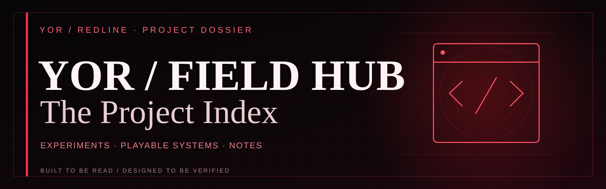
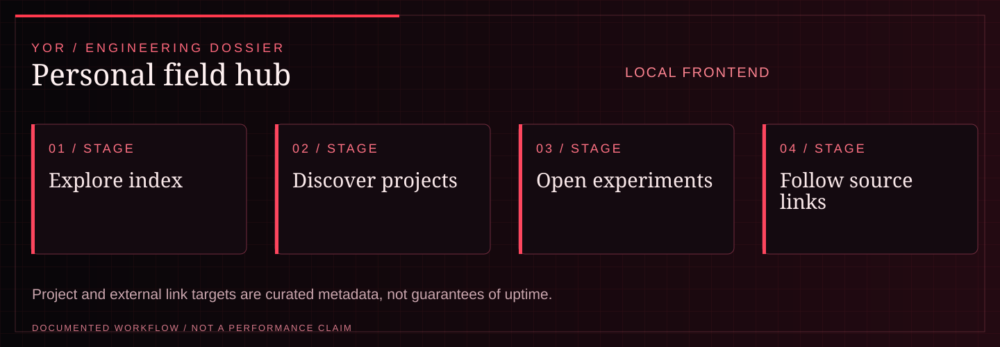

<!-- YOR REDLINE / README COVER V1 -->
<div align="center">

<picture><source media="(max-width: 600px)" srcset="docs/yor-redline-cover-mobile.svg"/></picture>

<sub><strong>YOR / PROJECT DOSSIER</strong> · <a href="https://github.com/yorayriniwnl">GitHub</a> · <a href="https://yorayriniwnl.in">Portfolio</a></sub>

</div>
<!-- END YOR REDLINE -->

# YOR // Field Hub

> A personal internet index for shipped work, experiments, playable systems, and field notes.

| Surface / claim | State | Boundary |
|---|---|---|
| Vite React hub composition | VERIFIED | Buildable local frontend with accessible section navigation and game modal boundaries. |
| Arcade launcher | DEMO | Games run in the local client; individual game depth is intentionally separate from the hub shell. |
| Project and archive links | REPORTED | Link targets are authored metadata and should be rechecked before relying on them. |
| Media artifacts | EXPERIMENTAL | Visual previews are presentation assets, not deployment telemetry. |
| Public deployment | UNVERIFIED | Hosting and external-link health require a live check. |
| Additional integrations | PLANNED | Broader accounts and data sources remain outside this repository's verified runtime. |

The shell follows the YOR visual contract: `#000000` void, `#050505` graphite,
`#e84b4b` crimson, `#671515` deep crimson, `#ff8a7f` signal, `#f5eaea` warm white,
`#c4c4c4` muted text, and the `#671515 → #8c1616 → #2a0505` field gradient.
Run `npm run design:check` to guard the contract.

The broader personal internet around the portfolio: experiments, shipped project links, playable games, field notes, media, and activity.

The canonical recruiter-facing portfolio is maintained in [Portfolio-Ayush-Roy](https://github.com/yorayriniwnl/Portfolio-Ayush-Roy) and deployed at [yorayriniwnl.in](https://yorayriniwnl.in). This repository is a separate experimental field hub and is not the source of the canonical portfolio.

<!-- YOR REDLINE / EXPERIENCE V2 -->

<a id="system-map"></a>
## System map

<div align="center"><picture><source media="(max-width: 600px)" srcset="docs/yor-redline-system-mobile.svg"/></picture></div>

| Project signal | Documented scope |
| :--- | :--- |
| **Current maturity** | LOCAL FRONTEND |
| **Technical focus** | Vite/React project index, experiment launcher, game modal, and field-note links. |
| **Evidence boundary** | Project and external link targets are curated metadata, not guarantees of uptime. |

**Navigate:** [Run locally](#run-locally) · [Build](#build) · [Structure](#structure)

<!-- END YOR REDLINE / EXPERIENCE V2 -->

## Run locally

```bash
npm install
npm run dev
```

## Build

```bash
npm run build
npm run preview
```

## Structure

- `src/App.tsx` — hub composition, project index, arcade launcher, and archive content.
- `src/styles.css` — the visual system and responsive layout.
- `src/games/` — lazy-loaded playable experiences.
- `src/data/`, `src/hooks/`, and `src/lib/games/` — game data and reusable game logic.

Games open in an accessible full-screen modal so the main field stays lightweight and the experiences stay contained.
